# 原有新闻 NLP 工作流优化方案

> 文档状态：待实施设计方案。本文记录讨论形成的改造思路，不表示相关代码已经完成修改。
>
> 整理日期：2026-11-23。
>
> 适用范围：以项目原有的 NLTK、VADER 和加密货币词典为基础，优化新闻采集、文本处理、情绪评分、周度聚合、预测接入及展示流程。

## 一、优化目标与原有流程

本方案继续使用原项目的 **NLTK＋VADER＋加密货币词典**。优化重点是修复输入信息损失、统一统计口径、保留数据来源、建立可靠评价，再逐步增加事件与币种分析能力。

原有调用关系：

```text
stage1_load_news()
    ↓
stage1_clean_text()
    ↓
stage2_sentiment()
    ↓
merge_sentiment_feature()
    ↓
收益率预测、词云、情绪仪表
```

主要代码位置：

| 文件 | 原有职责 |
| --- | --- |
| [crypto_project_pipeline.py](./crypto_project_pipeline.py) | 新闻采集、清洗、VADER 评分、周度聚合、特征合并及图表生成 |
| [run_crypto_project_pipeline.py](./run_crypto_project_pipeline.py) | 原研究数据处理入口 |
| [sentiment_update.py](./sentiment_update.py) | 原情绪页面的独立更新流程 |
| [customer_side.py](./customer_side.py) | 增量更新及客户端预测 |
| [crypto_pipeline_stage3.py](./crypto_pipeline_stage3.py) | 情绪评价和原研究预测实验 |

以下新增函数名、字段及输出目录均为拟议设计。实际实施时，应复用后续共享更新流程已经具备的能力。

优化后的目标流程：

```mermaid
flowchart TD
    A["增量抓取新闻，保存原始响应"] --> B["字段校验、时间统一、质量标记"]
    B --> C["重复文章识别"]
    C --> D["保留语义的评分文本"]
    C --> E["用于词频统计的清洗文本"]
    D --> F["VADER评分与评分缓存"]
    F --> G["固定截止时间的周度聚合"]
    G --> H["与行情特征合并"]
    H --> I["质量校验、发布同一版本"]
    E --> J["词频、词云"]
    G --> K["情绪仪表"]
```



## 二、第一步：冻结原版基线

先选择一批已有新闻，保存当前代码生成的清洗结果、文章分数和周度特征，作为优化实验的基线。

每个基线版本记录：

- 输入文件及其哈希、新闻数量、日期范围。
- 原始文章 ID、标题、正文和现有情绪结果。
- Python、NLTK 及相关资源版本。
- 自定义词典内容、哈希和处理参数。
- 原版文章评分结果、周度特征及运行配置。

之后在同一批新闻上逐步比较改动，避免数据变化掩盖算法变化。

| 实验 | 主要变化 | 要回答的问题 |
| --- | --- | --- |
| A | 原始流程 | 原版表现如何 |
| B | 修改评分文本清洗 | 保留否定、程度等信息是否改善判断 |
| C | 在 B 上增加去重 | 重复报道对统计结果影响多大 |
| D | 在 C 上修改周度统计 | 特征是否跨周可比、是否只使用当时已知信息 |
| E | 增加标题、句子或币种分析 | 新增复杂度是否带来可验证的收益 |

原版结果保存在独立版本中。新版本改变分数或特征定义后，整个比较区间按同一版本重新计算，避免将旧历史分数与新计算分数拼接。

## 三、第二步：改造新闻采集与规范化

### 3.1 调整 `stage1_load_news()` 的职责

原函数会删除 URL、来源等字段，再保存为 `stage_1_news_raw.csv`。优化后先保留完整原始响应，再生成供后续处理的规范文章表。

| 字段 | 用途 |
| --- | --- |
| `article_id` | 标识文章 |
| `source`、`url` | 追查来源、辅助去重 |
| `title`、`body` | 保留原始文本 |
| `published_at` | 上游声明的发布时间 |
| `first_seen_at` | 系统首次实际采集时间 |
| `text_hash` | 判断正文是否变化 |
| `language` | 确认适用的语言处理流程 |
| `text_status` | 正文完整、仅标题、正文为空等状态 |

上游情绪标签保留原值，并注明标签来源，供辅助对照使用。

### 3.2 增加抓取状态与增量更新

抓取过程增加请求超时、有限重试、分页进度检查和断点记录。接口失败时记录失败范围，避免将请求中断解释为该时间段没有新闻。

日常更新只抓新增区间，并适度重叠抓取最近一段时间以接收迟到文章，再按 ID 和内容去重。重叠长度作为配置保存，不在代码中隐式变化。

已有历史缓存如果缺少首次采集时间，应明确标记可用时间尚未核实，不补造历史记录。新导入旧文章的时间也不能直接作为它在历史上首次可用的时间。

每次采集输出质量报告：

```text
请求时间范围
实际返回时间范围
新增文章数量
重复文章数量
正文缺失数量
失败请求及未覆盖区间
```

### 3.3 该阶段验收

重复运行同一抓取区间，不产生重复文章记录；请求失败能够定位到具体范围；每条评分结果都能追溯到原始文章及来源。

## 四、第三步：识别重复内容，保留有效更新

先完成容易验证的精确去重，再逐步增加转载识别。

处理顺序：

```text
相同新闻 ID
    ↓
相同规范 URL
    ↓
相同正文哈希
    ↓
标题、正文高度相似的转载候选
```

| 情况 | 处理方式 |
| --- | --- |
| 同一文章重复采集 | 合并重复记录 |
| 同一内容被转载 | 统计时降低重复影响 |
| 多家媒体对同一事件提供不同信息 | 保留报道，关联事件 |
| 同一事件出现新进展 | 保留更新及其时间 |

所有原始文章仍有记录。去重结果通过 `duplicate_group_id` 和代表文章关联，记录识别规则及版本，避免静默删除资料。

例如，同一公告被多个网站原样转载时，情绪统计应避免将它重复累加；后续报道增加新事实时，应作为更新保留。

第一版优先完成精确去重。事件聚类作为后续增强，记录每次归类的时间与版本。未来新增报道不能重新改写过去决策已经使用的事件状态。

## 五、第四步：将文本清洗拆成两条支路

### 5.1 原有问题

原 `_preprocess_text()` 依次分词、转小写、删除非字母词和英文停用词，再做词形还原。生成的 `reviewText` 同时用于情绪评分和词频统计。

这一处理会删除 VADER 可以使用的部分语言线索，包括否定词、程度词、大小写及标点强调。

例如：

```text
原文 A：The market is bullish!!!
原文 B：The market is not bullish!!!

旧流程清洗后，两者都是：market bullish
```

### 5.2 优化后的输出

| 输出字段 | 处理方式 | 下游用途 |
| --- | --- | --- |
| `sentiment_text` | 去 HTML、明确模板及多余空白，保留语言线索 | VADER 情绪评分 |
| `keyword_text` | 小写、去停用词、词形还原 | 词频和词云 |

评分支路保留：

- `not`、`never`、`no` 等否定词及否定缩写。
- `very`、`slightly` 等程度词。
- 大小写、感叹号、问号及句界。
- 数字、金额和币种名称，供后续事件分析使用。

原始标题、正文永久保留。词频支路产生的文本不再传回情绪评分支路。

### 5.3 缺失文本处理

正文为空时，不把缺失值转换成字符串 `"nan"` 后打分。可以使用仅标题评分，但必须记录 `text_status=title_only`；完全没有有效文本时，分数保持缺失。

### 5.4 该阶段验收

建立否定、程度、转折、标点、标题缺失及正文缺失等案例。检查处理后的文本是否保留了预期信息，再核验 VADER 评分是否符合预期。保留信息并不保证 VADER 能处理所有复杂语义，错误案例需要继续记录。

## 六、第五步：整理词典并完善文章评分

### 6.1 检查词典实际命中

当前 `crypto_lexicon` 实际有 182 条词条，其中 97 条包含下划线，无法经过现有正文清洗路径正常匹配。

对每个词条生成检查结果：

```text
词条
命中次数
命中原文
权重
对应文章的分数变化
```

`bullish`、`hack` 等单词可以继续使用 VADER 扩展词典。对 `ETF approval` 等短语，先做独立识别，保存原文位置、上下文及规范名称。

不能直接将所有短语命中都转换成固定正负分，例如：

```text
ETF approval was confirmed.
ETF approval was denied.
Rumors of ETF approval spread.
```

这些句子表达不同的事件状态。第一阶段先保存短语命中，复杂的否认、传闻和引述标记为待核验；经人工样本验证后，再决定怎样影响文章分数。

### 6.2 完善文章级输出

| 字段 | 含义 |
| --- | --- |
| `compound`、`neg/neu/pos` | VADER 分数 |
| `sentiment_label` | 正面、中性、负面 |
| `score_status` | 成功、文本不足、评分失败 |
| `phrase_hits` | 命中的领域短语及位置 |
| `scorer_version` | 评分逻辑版本 |
| `lexicon_version` | 词典版本 |

三分类先从以下阈值开始验证：

```text
compound > 0.05   → 正面
compound < -0.05  → 负面
其余             → 中性
```

阈值通过验证集评估后确定。“不确定”和“评分失败”单独记录，不并入中性。

### 6.3 试验标题与句子级聚合

较长文章可以试验标题、正文句子分别评分，再聚合成文章分数，检查全文累加、重复句和文章长度对分数的影响。

实验先以正文句子等权均值作为候选，再比较是否需要结合标题。标题权重和聚合方法均作为实验参数，不能根据测试集反复调整。

标题或正文缺失时，对可用部分重新归一化权重，不把缺失当作中性 0 分。保留原全文评分用于对照；候选方案经验证优于轻清洗全文评分后，才进入正式流程。

## 七、第六步：分离评分、周度聚合与图表生成

原 `stage2_sentiment()` 同时承担文章打分、分类、画图、分位数计算和周度汇总。建议拆成：

```text
score_articles()       生成文章分数
aggregate_weekly()     生成周度特征
render_sentiment()     生成展示图表
```

这样修改图表样式无需重新评分，修改周窗口也能复用已有文章分数。

### 7.1 明确统计截止时间

假设采用“截至周三结束”的口径：

```text
T = 周四 00:00 UTC
统计区间 = [T - 7天, T)
```

周均值、极端比例、新闻数量和图表全部使用同一区间。预测的数据截止时间与决策时间保持一致。

历史回放还需满足当时可获得的条件。实时采集依据实际观测时间约束；旧缓存只有发布时间时，应注明它是可用时间的代理。已经完成的历史决策不能被后来抓到的新闻静默回填。

### 7.2 统一三个原有周特征的定义

第一版保留原有三个字段，但使用同一明确窗口：

```text
compound_weekly = 窗口内有效、去重后的文章 compound 均值
```

极端阈值先采用初始训练期固定阈值：在初始训练数据上计算 q10、q90，冻结用于整个后续比较区间。

```text
extremely_positive_ratio
    = compound > 训练期 q90 的文章数 / 有效文章数

extremely_negative_ratio
    = compound < 训练期 q10 的文章数 / 有效文章数
```

第一版在初始训练期结束时确定阈值，后续每周模型重训也不自动改变它。不在完整研究区间上拟合阈值，也不使用测试周或未来新闻重新确定阈值。

这样，各周面对相同的衡量基准，极端比例可以随情绪分布变化。后续如采用过去窗口动态阈值，也必须只使用当时已知数据，并保存阈值来源和回退规则。

### 7.3 输出覆盖信息

```text
news_count
valid_score_count
duplicate_count
score_coverage
window_start
window_end
threshold_version
```

没有新闻时，均值和比例保持缺失。采集失败、评分失败、确实没有新闻分别标记。

某一天没有文章，不能单独证明采集不完整。应结合请求状态、分页结果和覆盖记录判断。

## 八、第七步：安全接入现有预测流程

### 8.1 第一阶段保留市场层接口

原 `merge_sentiment_feature()` 按日期合并三个情绪字段，并将缺失填为 0。

第一阶段仍按 `date` 合并市场情绪，另外保留可用状态。是否填补缺失值，由预测端在训练数据范围内统一处理，同时保留缺失指示，区分缺失和真实中性。

虽然字段名可以兼容，优化后的统计定义已经改变，因此应使用独立版本目录和元数据，并按统一定义重新生成训练区间。

### 8.2 显式指定预测特征

预测输入改为明确的特征白名单。原版 `all` 会自动纳入许多未排除列，新增版本号、状态和诊断字段后，容易被错误送入模型。

运行时间、文章 ID、质量报告字段及版本信息只用于追踪；新计数或覆盖变量是否参与预测，需要单独验证。

### 8.3 第二阶段增加币种层分析

在市场层流程稳定后，增加：

```text
文章 → 币种候选 → 原文归因证据 → 币种情绪
```

通过名称、别名和 ticker 召回候选，再处理歧义、多币文章及仅顺带提及的对象。无法可靠归因时保留不确定状态。

市场特征继续按 `date` 连接，币种特征按 `date + symbol` 连接。第一轮只增加少量变量，例如逐币情绪均值及独立相关新闻数量。

同一周所有币共享的市场情绪，表达共同背景；逐币特征用于提供币种之间有区别的信息。

## 九、第八步：缓存评分并统一发布数据版本

### 9.1 版本化缓存

评分缓存标识包含所有影响结果的因素：

```text
文本哈希
清洗版本
NLTK/VADER 版本
词典版本
评分参数版本
```

文本和算法均未变化时复用结果。修改清洗或词典后重新评分，避免不同算法定义被写入同一历史列。

NLTK 资源准备移到环境初始化阶段，避免导入业务模块时反复触发下载。

### 9.2 同一批数据一次发布

拟采用独立运行目录，例如：

```text
artifacts/nlp_workflow/<run_id>/
    raw_news.jsonl
    articles.csv
    article_scores.csv
    weekly_features.csv
    quality_report.json
    manifest.json
    figures/
```

目录和格式在实施时确定。核心要求是原始输入、处理结果、版本配置和质量报告能够对应。

一次运行的文章结果、周特征和图表全部校验成功后，再一起发布。网页和预测读取同一版本。

更新失败时保留上一个完整版本，并显示更新失败或数据过期状态，避免图片、周表和预测来自不同批次。

### 9.3 展示口径

词云与仪表使用同一批已发布数据，显示统计区间、样本数量及覆盖状态。

词云采用明确标注的口径：保留原版正负词词云，或采用按文章分组生成的词云，两者不能混用名称和解释。仪表继续显示周均新闻情绪的线性映射，并注明它是项目的新闻情绪刻度。

## 十、验证与验收

### 10.1 建立独立文章评价集

先建立约 800 条人工标注样本作为第一轮实验：约 500 条代表正常分布，约 300 条覆盖否定、多币种、攻击、监管、传闻和其他困难情况。两部分分别报告结果。

标注目标对象、情绪、事件类型及原文依据，一部分由两人独立标注并核对分歧。标注依据是文章当时表达的内容，不使用后来涨跌反推标签。

按时间划分开发、验证和测试数据，同一事件的重复报道避免跨集合泄漏。测试集固定后，不反复据此调整规则和阈值。

API 自带标签保留为辅助对照，不代替独立人工评价。

### 10.2 分层验收

| 验收层 | 重点检查 |
| --- | --- |
| 文本处理 | 否定、程度、句界和缺失正文是否正确处理 |
| 文章评分 | 人工标注集上的分类表现、负面召回及错误案例 |
| 数据时间 | 截止时刻之后的新闻不能改变此前结果 |
| 周度特征 | 阈值只来自过去，缺失与中性可区分 |
| 可复现性 | 相同输入及配置能够重现相同结果 |
| 运行流程 | 重复更新不产生重复记录，失败保留完整旧版本 |
| 预测价值 | 保持行情变量、模型和训练窗口相同，仅比较新闻特征变化 |

新闻情绪识别能力和收益率预测价值分别评价。原来的 `all/market` 还存在其他行情变量差别，不能直接作为纯新闻消融实验。

下游验证采用严格时间顺序和滚动训练；先比较原 NLP 与新 NLP，再以完全相同的行情特征比较增加或删除新闻变量后的排名相关性与稳定性。情绪更准确不自动意味着预测收益提高。

## 十一、实施批次与交付内容

| 批次 | 实施内容 | 交付和进入下一批的依据 |
| --- | --- | --- |
| 第一批 | 冻结基线、保留采集记录、拆分两路清洗、完善文章状态 | 原版与修正版文章结果、语义案例及独立评价结果 |
| 第二批 | 精确去重、版本缓存、统一周窗口与训练期阈值、缺失处理、完整版本发布 | 可复现周特征、质量报告、无未来信息检查及预测对照 |
| 第三批 | 按错误分析增加短语处理、事件关联、标题句子聚合及逐币归因 | 各增强项独立实验结果，再决定是否正式采用 |

每一批保留配置、输入版本、评价结果和回退版本。优先解决已经证实的问题，后续增强以验证结果决定是否进入正式工作流。
